# Retro Bub: Game Bub rev2 case

**A redesigned Game Bub rev2 case, optimized for FDM 3D printing.**

This is a redesigned case for the [Game Bub](https://github.com/elipsitz/gamebub) rev2 handheld by Eli Lipsitz, made to print well on ordinary desktop FDM printers (developed and tested on a Bambu Lab P1S and a Snapmaker U1). Every part was designed for FDM and then printed, assembled and adjusted until it worked:

- **Print orientation:** each part has a flat face on the build plate. Only the front needs supports, and only under the screen ledge.
- **Printable geometry:** chamfers instead of rounded edges on the plate side, and wall thicknesses sized to whole extrusion lines.
- **Fits:** the clearances for buttons, springs, inserts and the cover joint were checked on real prints, not only in CAD.
- **Graphics:** logos and graphics are printed as colour inlays in the first layers on the plate, so they come out sharp without painting.

It keeps the original vertical layout and PCB and adds:

- **New 3DS screen glass:** a flat front for a standard New 3DS (2015, small) top-screen replacement lens, 91 × 57 × 1.0 mm.
- **Nintendo buttons:** pockets for aftermarket New 3DS XL ABXY / D-pad buttons on Nintendo DSi membranes.
- **Volume and power:** a rocker volume button and a reworked power button.
- **Shoulder buttons:** larger caps with printed V-springs.
- **Top cover:** a lip that locks the front, plus an edge that closes the gap around the cartridge connector.
- **Multicolour inlays (optional):** the parts are designed so logos and graphics can be inlaid.

Firmware for the device: [retrobub-firmware](https://github.com/florin-byte/retrobub-firmware).

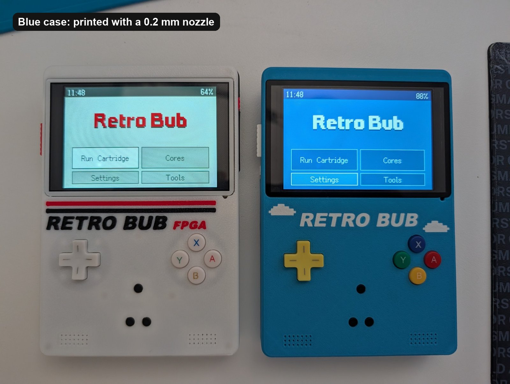

*The assembled blue case was printed with a 0.2 mm nozzle (P1S); the unassembled blue parts further down with a 0.4 mm nozzle. The white case was printed with a 0.4 mm nozzle (U1).*

| | |
|---|---|
| 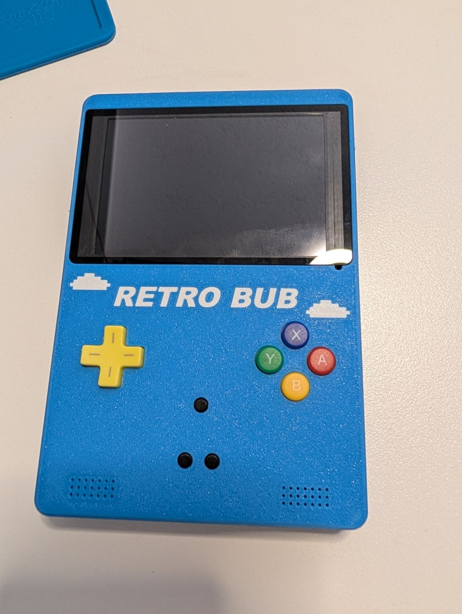 | 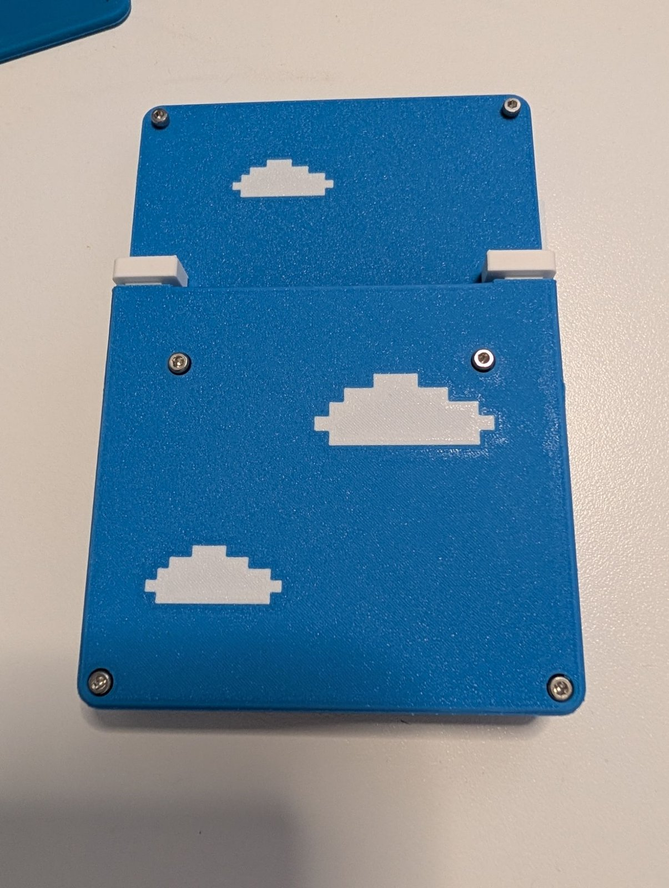 |
| 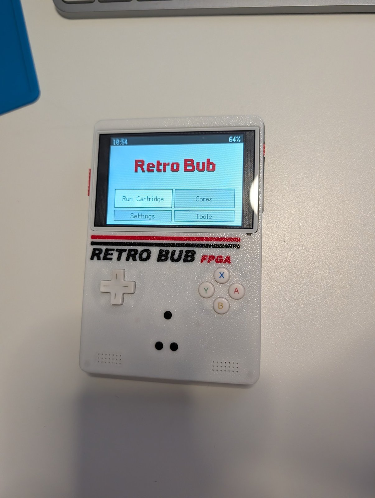 | 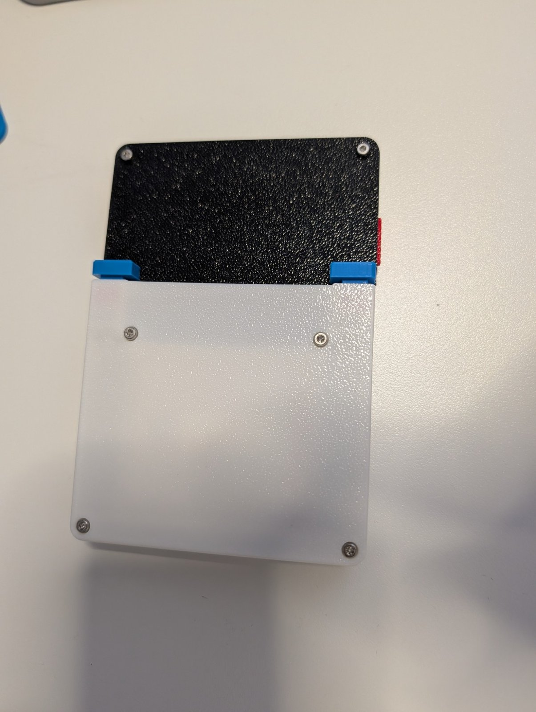 |

## Parts

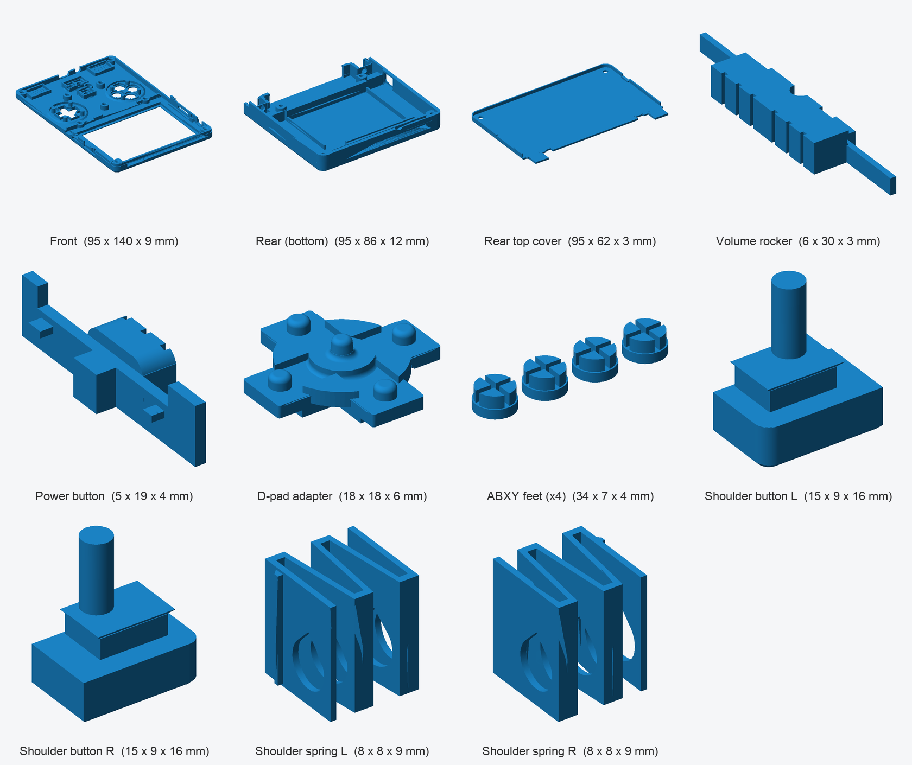

All STL files in [`stl/`](stl) are already oriented for printing.

| File | Part | Material | Notes |
|---|---|---|---|
| `front.stl` | Front shell | PLA | Glass side down. **Needs supports** under the glass/LCD ledge (build plate only). With Support for PLA as interface material, use a **concentric** interface pattern so short lines do not lift. |
| `rear-bottom.stl` | Rear shell, bottom part | PLA | Back face down, no supports |
| `rear-top-cover.stl` | Rear top cover | PLA | Outer face down, no supports |
| `volume-rocker.stl` | Volume rocker | PLA | As oriented, no supports |
| `power-button.stl` | Power button | PLA | As oriented, no supports |
| `dpad-adapter.stl` | Adapter between the New 3DS XL D-pad and the DSi membrane | PLA | Cross side down, supports recommended |
| `abxy-feet-x4.stl` | Feet under the 4 ABXY caps (press onto the DSi membrane) | PLA | No supports |
| `shoulder-button-left.stl` / `-right.stl` | Shoulder buttons | PLA (PLA Tough recommended) | Cap down, 0.08 mm layers, no supports |
| `shoulder-spring-left.stl` / `-right.stl` | Shoulder V-springs | **PETG** | No supports. Print with a 0.4 mm nozzle; with a 0.2 mm nozzle add a 5 mm brim. |

Start, Select and Home use the printed buttons from Eli's repository ([`3d/handheld_rev2`](https://github.com/elipsitz/gamebub/tree/main/3d/handheld_rev2), `ExtButtonArray.stl`).

### Print settings used

- **Printers:** Bambu Lab P1S and Snapmaker U1.
- **Default:** 0.4 mm nozzle, 0.20 mm layers, 3 walls, 20 % infill, textured PEI plate.
- **0.2 mm nozzle:** 0.10 mm layers, for crisper inlays and text. The parts themselves look almost the same with either nozzle.

## Ready-to-print colour projects (3MF)

The two cases from the photos are in [`3mf/`](3mf). In each project all three case parts (front, rear bottom, top cover) are already placed on one plate, with the colour parts and print settings. The logo and graphics are 0.4 mm inlays printed on the build plate.

| Project | Printer | Filament slots |
|---|---|---|
| `retrobub-clouds-P1S-0.4mm.3mf` (blue with clouds) | Bambu Lab P1S + AMS, 0.4 mm nozzle (about 2 h 35 min) | 1 Bambu PLA Tough+ blue (body), 2 white (clouds, logo), 3 black (screen mask under the glass), 4 Bambu Support for PLA (support interface under the LCD ledge) |
| `retrobub-clouds-P1S-0.2mm.3mf` (blue with clouds, sharper logo and clouds) | Bambu Lab P1S + AMS, 0.2 mm nozzle, 0.10 mm layers (about 14 h 30 min) | Same slots as the 0.4 mm version |
| `retrobub-classic-U1-0.4mm.3mf` (white with stripes) | Snapmaker U1, 0.4 mm nozzles (about 2 h) | Head 1 white (front, rear bottom, supports), 2 red (stripe, "FPGA"), 3 black (stripe, logo, screen mask, top cover); head 4 unused |

When you open a project, sync the filaments with your AMS or toolheads, and check that each colour is in the right slot.

## Shoulder buttons

The shoulder buttons sit on printed PETG V-springs, one per side. Each spring fills the full width of the pocket in the rear shell, and the button stem (Ø3.5 mm) goes through the spring and presses the PCB's shoulder switch.

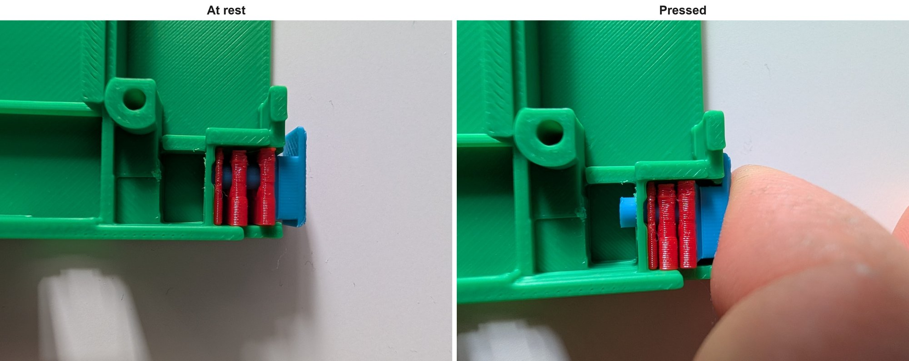

*Test print. The shoulder button shown is an earlier version; the current one has a larger, thicker cap.*

| | |
|---|---|
| 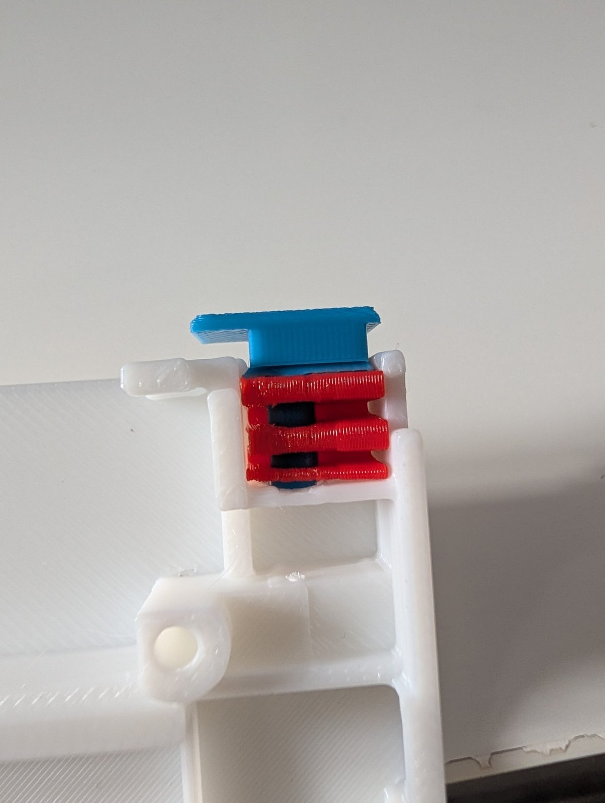 | 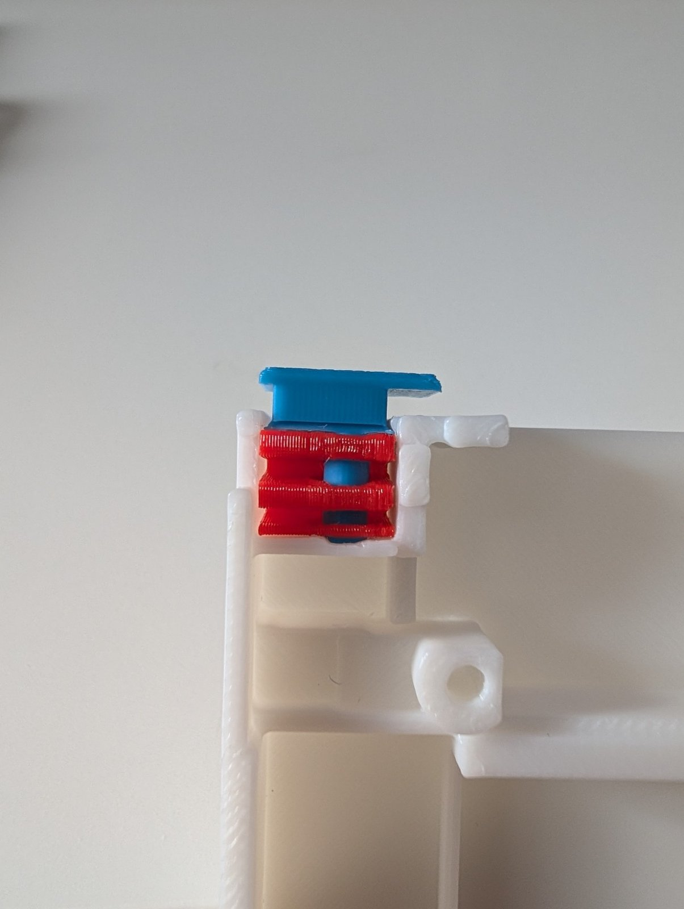 |

## Hardware

Besides the Game Bub rev2 PCB, LCD (ER-TFT035IPS-6), battery and speakers from [Eli's build guide](https://github.com/elipsitz/gamebub/blob/main/docs/building.md):

- New 3DS (2015, small) top-screen replacement lens, 91 × 57 × 1.0 mm, with black print
- New 3DS XL replacement ABXY buttons and D-pad
- Nintendo DSi button membranes (ABXY and D-pad)
- 9 × M2.5 heat-set brass inserts, 4 mm long, Ø3.5 mm knurl (holes are Ø3.5 × 4.5 mm). Install them with heat, no glue needed.
- M2.5 screws, the same as in Eli's guide:
  - 5 × 5 mm: 3 for the PCB, 2 for the top cover corners
  - 4 × 14 mm: middle and bottom, through the rear and the PCB into the front

## Assembly

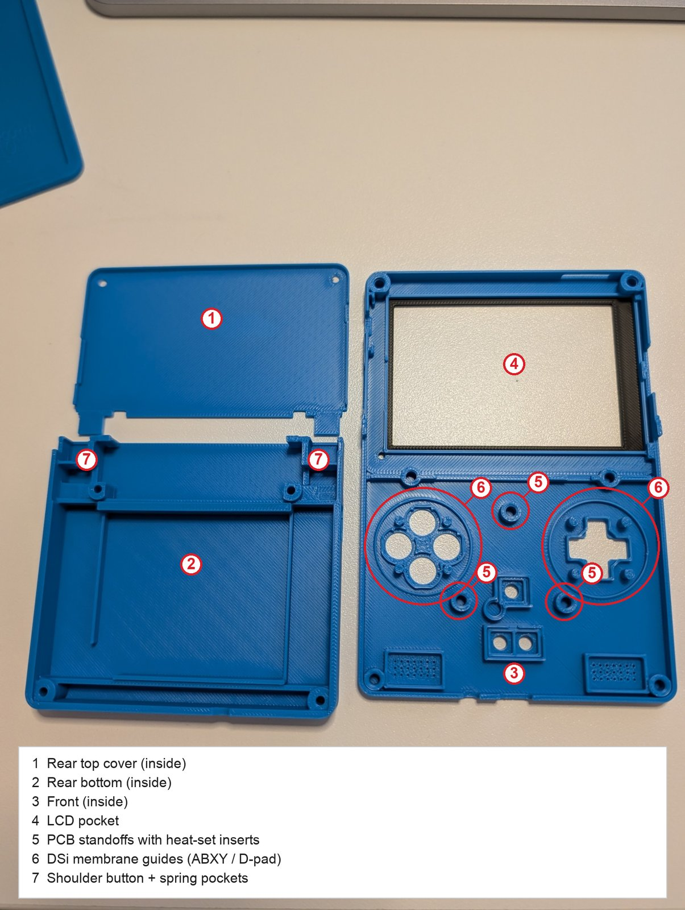

1. Install the 9 heat-set inserts in the front shell.
2. Stick the glass into its recess (thin double-sided adhesive or glue), then place the LCD into its pocket behind it.
3. Insert the speakers. Then place the ABXY caps with their feet, the D-pad with its adapter, and the DSi membranes.
4. Screw the PCB onto the 3 standoffs (M2.5 × 5). No washers are needed.
5. Insert the volume rocker and the power button into their slots.
6. Assemble the shoulder buttons and springs into the rear shell pockets.
7. Close the case with the rear bottom part (4 × M2.5 × 14) and the top cover (2 × M2.5 × 5). The cover's lip goes over the front.

### More photos

| | | |
|---|---|---|
| 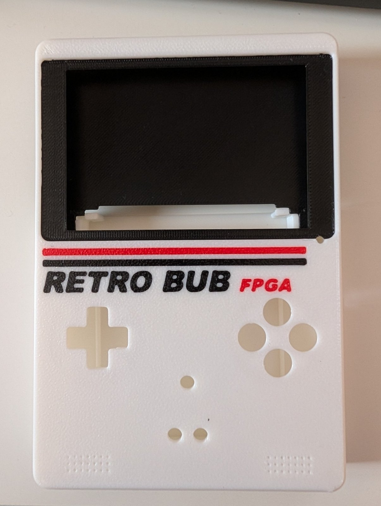 | 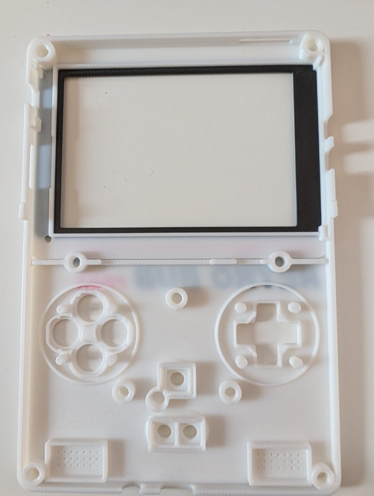 | 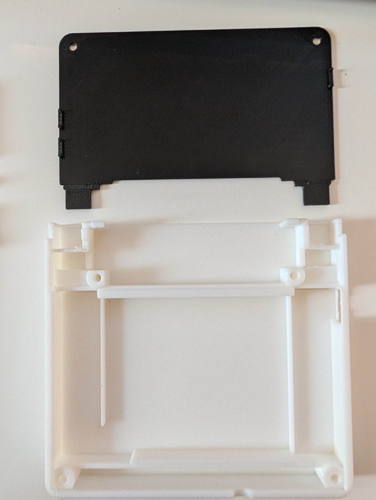 |
| 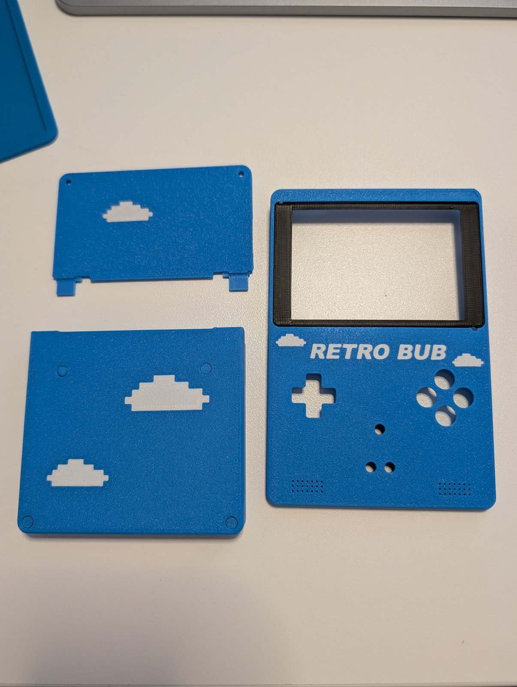 | 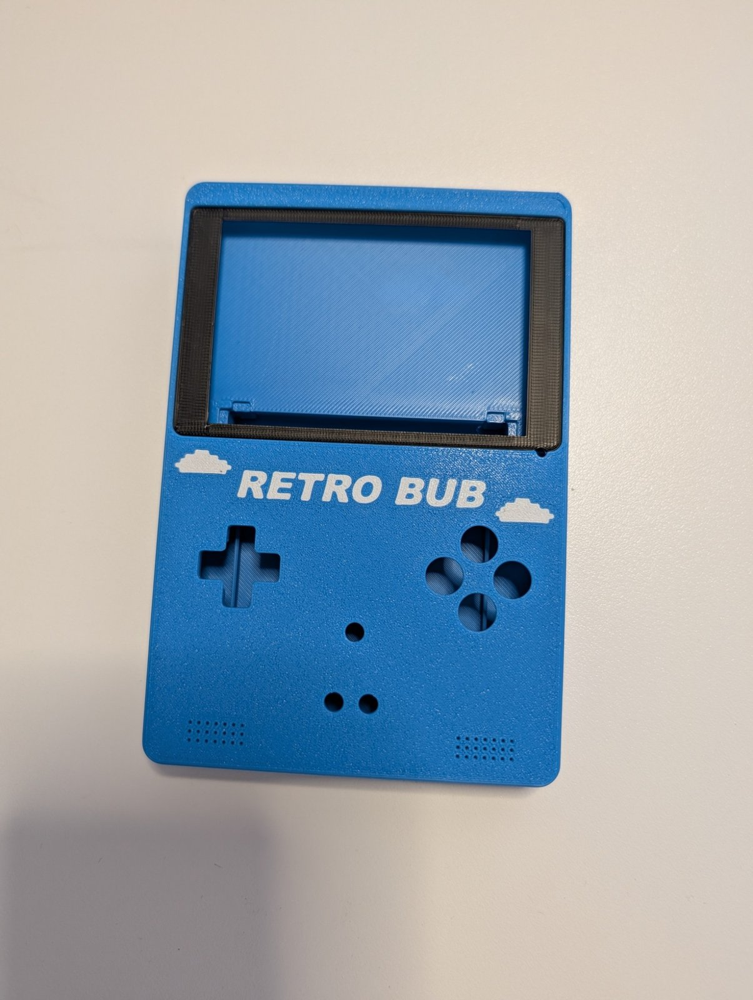 | 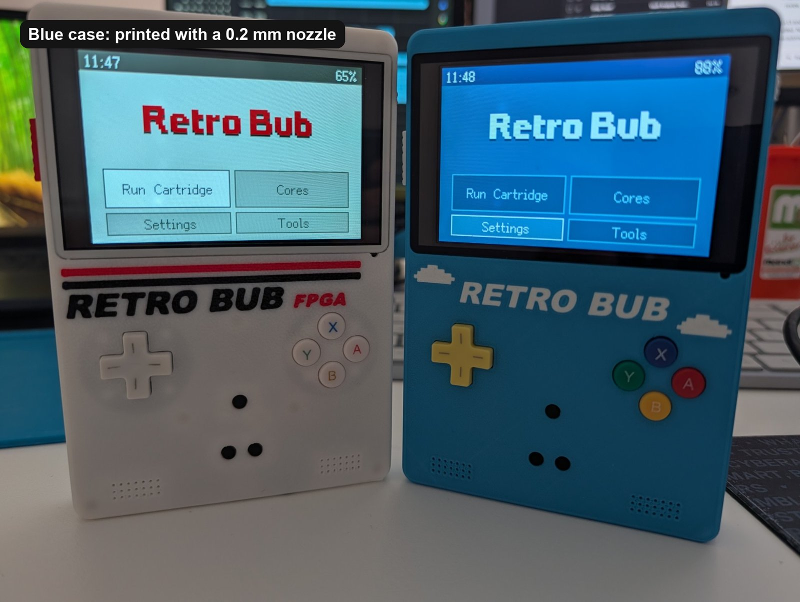 |

## Credits and license

- **Game Bub:** © Eli Lipsitz ([elipsitz/gamebub](https://github.com/elipsitz/gamebub)). This case is a derivative of the Game Bub rev2 3D files, which are licensed CC BY-SA 4.0.
- **ABXY mounting pattern:** adapted from loopj's New 3DS XL D-Pad and ABXY CAD files ([BitBuilt forum](https://bitbuilt.net/forums/threads/new-3ds-xl-d-pad-and-abxy-cad-files.6914/)). Those files are not included here.

The files in this repository are licensed under [Creative Commons Attribution-ShareAlike 4.0 International](LICENSE) (CC BY-SA 4.0).
